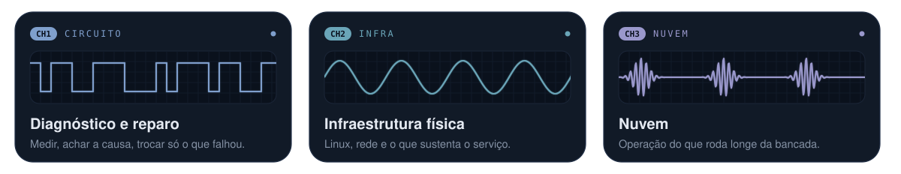

<div align="center">
  
</div>

<br/>

A eletrônica fica no centro: abrir, medir, achar a causa. Uso o mesmo método fora da placa, na infraestrutura física e na nuvem. Em Bauru, toco a [Cia. do Circuito](https://ciadocircuito.com.br/), um laboratório de eletrônica.

> Provar onde está a falha antes de trocar qualquer peça.

<div align="center">
  
</div>

<p align="center">
  <a href="https://thiagostropp.github.io/"></a>
  <a href="https://www.instagram.com/thiagostropp/"></a>
  
</p>

```console
thiago@bancada:~$ ./diagnosticar --antes-de-trocar
[ok] alimentação   [ok] sinal   [!!] causa-raiz encontrada
# nenhum capacitor foi maltratado nesta README
```
